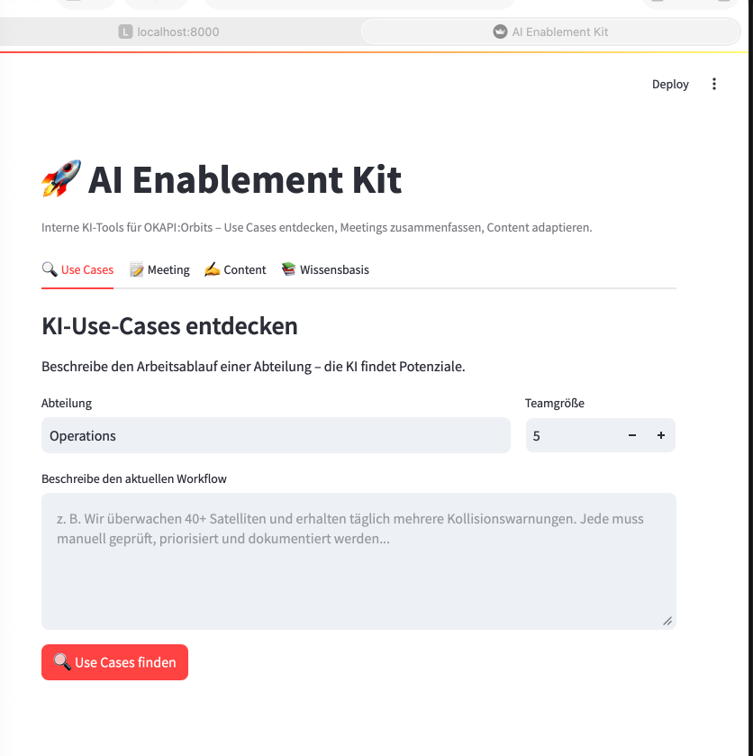

# AI Enablement Kit

[](https://www.python.org/)
[](tests/)
[](LICENSE)

Interne KI-Tools für OKAPI:Orbits – Use Cases entdecken, Automatisierungen bauen, Wissen dokumentieren, Kolleg:innen befähigen.
## Was es kann

- **Use Cases entdecken**: Beschreibe einen Arbeitsablauf → Claude findet 3–5 konkrete KI-Use-Cases mit Impact/Effort-Bewertung
- **Meetings zusammenfassen**: Transkript rein → Action Items, Entscheidungen, offene Fragen raus
- **Content adaptieren**: Ein Text → Varianten für LinkedIn, Newsletter, Slack, interne Doku
- **Wissensbasis**: Anleitungen, Use Cases und Best Practices durchsuchen

## Setup

```bash
python3 -m venv .venv
source .venv/bin/activate
pip install -r requirements.txt
cp .env.example .env       # ANTHROPIC_API_KEY eintragen
```

## Starten

Drei Terminals:

```bash
# Terminal 1: API
uvicorn src.api.main:app --reload

# Terminal 2: UI
streamlit run src/ui/app.py

# Terminal 3: Tests
pytest tests/ -v
```

- API: http://localhost:8000
- API-Docs (Swagger): http://localhost:8000/docs
- UI: http://localhost:8501

## Projektstruktur

- `src/core/`    – Config, Claude-Client, Knowledge Base
- `src/agents/`  – Discoverer, Builder, Documenter
- `src/api/`     – FastAPI-Backend
- `src/ui/`      – Streamlit-Frontend
- `scripts/`     – Demo-Skripte
- `docs/`        – Generierte Reports und Analysen
- `tests/`       – Pytest-Suite (10 Tests)

## Architektur

```
┌─────────────┐         ┌──────────────┐         ┌─────────────┐
│  Streamlit  │ ──HTTP─▶│   FastAPI    │ ──API──▶│  Claude API │
│     UI      │         │   Backend    │         │  (Anthropic)│
└─────────────┘         └──────┬───────┘         └─────────────┘
                               │
                        ┌──────▼───────┐
                        │   Agenten    │
                        ├──────────────┤
                        │ Discoverer   │
                        │ Builder      │
                        │ Documenter   │
                        └──────┬───────┘
                               │
                        ┌──────▼───────┐
                        │  Knowledge   │
                        │    Base      │
                        │   (SQLite)   │
                        └──────────────┘
```

## Tests

```bash
# Nur schnelle Tests (ohne API)
pytest tests/ -v -m "not slow"

# Alle Tests (mit echten Claude-API-Calls)
pytest tests/ -v
```

## Demo-Reports

- `docs/use-cases-report.md` – 20 Use Cases über 4 Abteilungen
- `docs/builder-demo.md` – Meeting-Summary + Content-Varianten

## Screenshot

